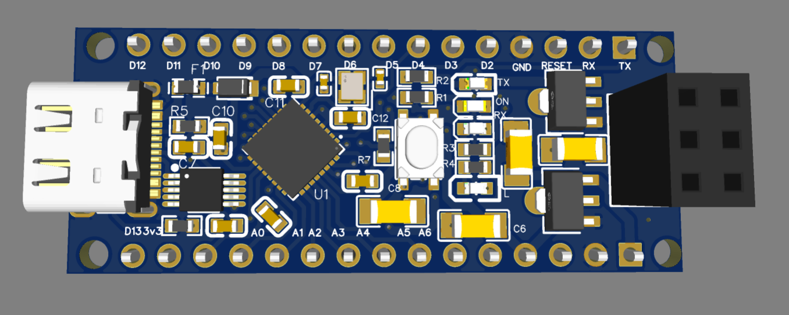
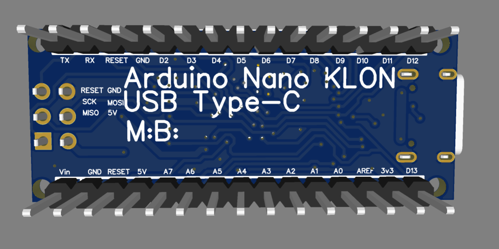
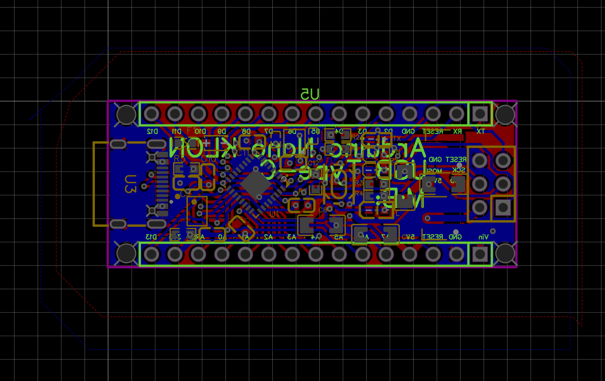

# Arduino Nano Type-C Clone

A custom-designed Arduino Nano-compatible development board featuring a USB Type-C connector.

## Overview

This project focuses on designing a compact Arduino Nano-compatible development board, including its schematic, PCB layout, and manufacturing documentation.

## Design Features

- Arduino Nano-compatible form factor
- USB Type-C connector
- ATmega328P microcontroller
- CH340 USB-to-serial interface
- 16 MHz clock
- Reset button
- GPIO, power, and serial connections

## 3D PCB Views

Visual renders of the PCB design:

## Project Structure

| Directory | Contents |
|---|---|
| `Design-Files/Schematic/` | Circuit schematic |
| `Design-Files/PCB/` | PCB layout source |
| `Manufacturing/Gerber/` | PCB manufacturing files |
| `Manufacturing/BOM/` | Bill of Materials |
| `Manufacturing/Pick-and-Place/` | Component placement data |
| `Images/` | PCB renders and design views |
| `3D-Model/` | Exported 3D model files |

## Design Software

- EasyEDA

## Project Status

Design files and manufacturing outputs are available. Physical production and hardware testing status will be documented separately.

## License

License information will be added after the project licensing terms are determined.

---

[Back to Main Repository](../README.md) | [Türkçe](../README_TR.md)
