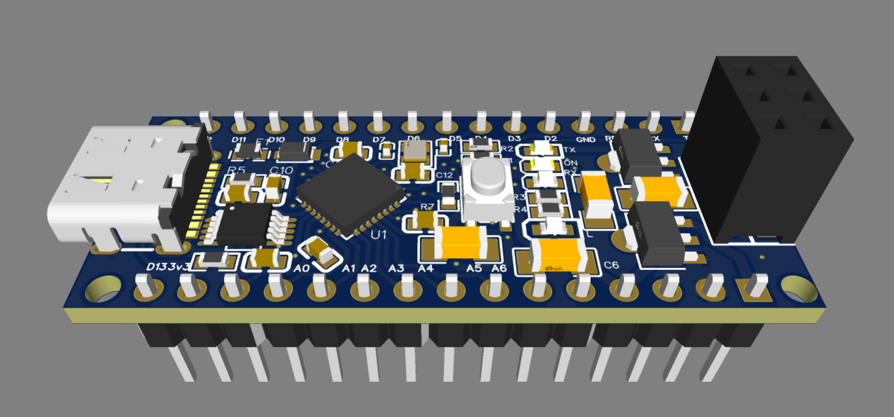

# Arduino Clone Projects

A collection of custom-designed Arduino-compatible development boards, developed with a focus on hardware design, PCB layout, and manufacturing documentation.

  

  <em>Custom Arduino Nano Type-C PCB Design</em>

## Projects

### Arduino Nano Type-C

A custom Arduino Nano-compatible development board featuring a USB Type-C connector.

**Project documentation includes:**
- Schematic design
- PCB layout
- Gerber manufacturing files
- Bill of Materials (BOM)
- Pick and Place files
- 3D PCB views

**Design files and documentation:** [Nano-Type-C](./Nano-Type-C/)

### Upcoming Projects
- Arduino UNO Clone
- Arduino MEGA Clone

## Tools & Technologies
- Electronic circuit design
- PCB design and layout
- Gerber generation
- BOM and Pick and Place documentation

## Project Status
The Arduino Nano Type-C design files are being documented. Hardware testing and manufacturing status will be updated when available.

## Language
- [Türkçe](./README_TR.md)

---

Developed as an independent hardware design project.
